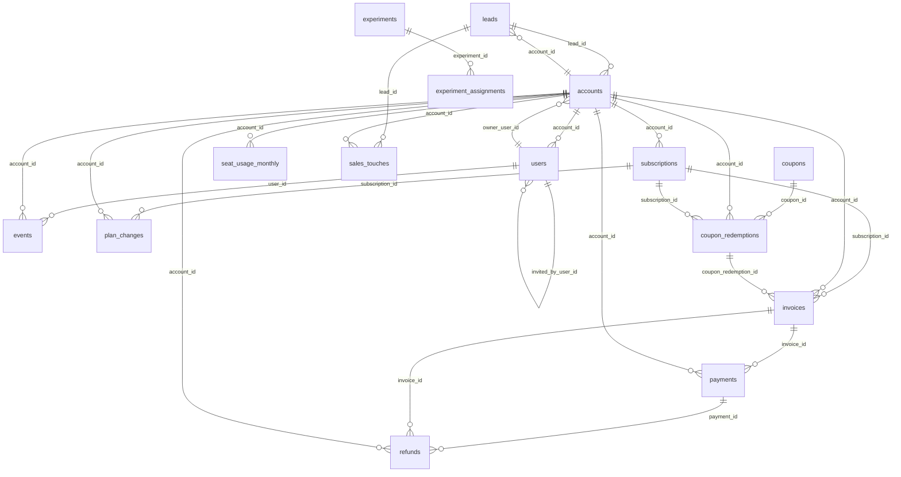

# Flowdesk Data Dictionary

Flowdesk is a product-led B2B SaaS team task app (Free / Pro / Business). Data covers **2023-01-01 to 2025-12-31**. All data is synthetic.

## Conventions

- Keys are integers. Foreign keys are **not enforced**; verify joins yourself.
- Timestamps are UTC unless stated otherwise.
- Money columns are in the row's `currency`; `*_usd` columns are USD equivalents.
- Plans: Free (up to 5 users), Pro ($12/seat/mo list), Business ($24/seat/mo list). Annual billing is 20% cheaper than monthly.
- This dictionary describes the *intended* contract of each column.

## Tables

| Table | Grain | Approx. rows |
|---|---|---|
| [accounts](#accounts) | one row per workspace (team) account | ~41,000 |
| [users](#users) | one row per person in a workspace | ~120,000 |
| [events](#events) | one row per product event | ~3.5M |
| [subscriptions](#subscriptions) | one row per paid subscription lifecycle | ~4,600 |
| [plan_changes](#plan_changes) | one row per subscription change | ~9,000 |
| [invoices](#invoices) | one row per invoice | ~45,000 |
| [payments](#payments) | one row per payment attempt | ~48,000 |
| [refunds](#refunds) | one row per refund | ~650 |
| [coupons](#coupons) | one row per coupon code | ~25 |
| [coupon_redemptions](#coupon_redemptions) | one row per coupon use | ~1,300 |
| [seat_usage_monthly](#seat_usage_monthly) | one row per account per month | ~300,000 |
| [experiments](#experiments) | one row per A/B test | ~6 |
| [experiment_assignments](#experiment_assignments) | one row per unit per experiment | ~60,000 |
| [marketing_spend](#marketing_spend) | one row per day per channel per campaign | ~13,000 |
| [platform_reported_conversions](#platform_reported_conversions) | one row per day per platform campaign | ~13,000 |
| [leads](#leads) | one row per sales/marketing lead | ~6,500 |
| [sales_touches](#sales_touches) | one row per rep interaction | ~30,000 |

## Relationships

## accounts

Every team workspace that signed up. Free and paid accounts alike.

**Grain:** one row per workspace (team) account  
**Approx. rows:** ~41,000

| Column | Type | Key | Null? | Description | Values / format |
|---|---|---|---|---|---|
| `account_id` | BIGINT | PK | no | Primary key. |  |
| `created_at` | TIMESTAMP |  | no | Signup time (UTC). |  |
| `company_name` | VARCHAR |  | no | Company/team name as typed by the owner. |  |
| `email_domain` | VARCHAR |  | yes | Owner's email domain; NULL for personal webmail. |  |
| `industry` | VARCHAR |  | yes | Self-reported industry; often blank. | software / agency / marketing / education / finance / healthcare / retail / manufacturing / nonprofit / other |
| `company_size_band` | VARCHAR |  | yes | Self-reported company size. | 1-10 / 11-50 / 51-200 / 201-1000 / 1000+ |
| `country` | VARCHAR |  | yes | ISO-3166 alpha-2 country code. | 2-letter code |
| `billing_currency` | VARCHAR |  | no | Currency the account is invoiced in. | USD / EUR / GBP / CAD / INR |
| `timezone` | VARCHAR |  | yes | Account IANA timezone. | e.g. America/New_York |
| `signup_source` | VARCHAR |  | yes | Raw acquisition label captured at signup; not normalized. |  |
| `utm_source` | VARCHAR |  | yes | UTM source at signup, if any. |  |
| `utm_medium` | VARCHAR |  | yes | UTM medium at signup, if any. |  |
| `utm_campaign` | VARCHAR |  | yes | UTM campaign at signup, if any. |  |
| `acquisition_motion` | VARCHAR |  | no | How the account was acquired. | self_serve / sales_assisted |
| `lead_id` | BIGINT | FK→leads.lead_id | yes | Lead record for sales-assisted accounts. |  |
| `owner_user_id` | BIGINT | FK→users.user_id | yes | User who created the account. |  |
| `sso_enabled` | BOOLEAN |  | no | SAML/SSO turned on (Business plan feature). |  |
| `lifecycle_stage` | VARCHAR |  | no | State as of snapshot date. | free / paid / churned |
| `first_paid_at` | TIMESTAMP |  | yes | First successful paid charge; NULL if never paid. |  |
| `churned_at` | TIMESTAMP |  | yes | When paid subscription ended; NULL if not churned. |  |

## users

Individual users belonging to an account.

**Grain:** one row per person in a workspace  
**Approx. rows:** ~120,000

| Column | Type | Key | Null? | Description | Values / format |
|---|---|---|---|---|---|
| `user_id` | BIGINT | PK | no | Primary key. |  |
| `account_id` | BIGINT | FK→accounts.account_id | no | Workspace the user belongs to. |  |
| `email` | VARCHAR |  | no | Synthetic email address. |  |
| `role` | VARCHAR |  | no | Workspace role. | owner / admin / member |
| `created_at` | TIMESTAMP |  | no | When the user joined (UTC). |  |
| `invited_by_user_id` | BIGINT | FK→users.user_id | yes | Inviter, if the user joined via invite. |  |
| `first_platform` | VARCHAR |  | yes | Platform of first session. | web / ios / android |
| `is_sso_provisioned` | BOOLEAN |  | no | Created automatically by SSO/SCIM. |  |
| `is_active` | BOOLEAN |  | no | Not deactivated as of snapshot date. |  |
| `deactivated_at` | TIMESTAMP |  | yes | Deactivation time, if any. |  |
| `last_active_at` | TIMESTAMP |  | yes | Last event timestamp seen. |  |

## events

Raw product analytics event stream (web, iOS, Android).

**Grain:** one row per product event  
**Approx. rows:** ~3.5M

| Column | Type | Key | Null? | Description | Values / format |
|---|---|---|---|---|---|
| `event_id` | BIGINT | PK | no | Primary key. |  |
| `event_ts` | TIMESTAMP |  | no | When the event occurred (documented as UTC). |  |
| `ingested_at` | TIMESTAMP |  | yes | When the event reached the warehouse. |  |
| `user_id` | BIGINT | FK→users.user_id | no | Acting user. |  |
| `account_id` | BIGINT | FK→accounts.account_id | no | Workspace of the acting user. |  |
| `event_name` | VARCHAR |  | no | Event type. | signup_completed / session_start / project_created / task_created / task_completed / task_assigned / comment_added / teammate_invited / invite_accepted / integration_connected / paywall_viewed / upgrade_clicked / checkout_started / subscription_started |
| `platform` | VARCHAR |  | no | Client platform. | web / ios / android |
| `app_version` | VARCHAR |  | yes | Client app version. | semver, e.g. 4.1.3 |
| `session_id` | VARCHAR |  | yes | Client session identifier. |  |
| `project_id` | BIGINT |  | yes | Project touched, if applicable. |  |
| `task_id` | BIGINT |  | yes | Task touched, if applicable. |  |
| `properties` | VARCHAR |  | yes | JSON string of extra properties. |  |

## subscriptions

A paid subscription (current state). Free usage has no subscription row. Change history lives in plan_changes.

**Grain:** one row per paid subscription lifecycle  
**Approx. rows:** ~4,600

| Column | Type | Key | Null? | Description | Values / format |
|---|---|---|---|---|---|
| `subscription_id` | BIGINT | PK | no | Primary key. |  |
| `account_id` | BIGINT | FK→accounts.account_id | no | Owning account. |  |
| `plan` | VARCHAR |  | no | Current plan. | pro / business |
| `billing_interval` | VARCHAR |  | no | Billing cadence. | monthly / annual |
| `seats` | INTEGER |  | no | Seats currently purchased. |  |
| `price_per_seat_usd` | DECIMAL(8,2) |  | no | Effective USD price per seat per month after interval discount. |  |
| `mrr_usd` | DECIMAL(12,2) |  | no | Current normalized monthly recurring revenue (USD). 0 if canceled. |  |
| `status` | VARCHAR |  | no | Subscription state. | active / past_due / canceled |
| `started_at` | TIMESTAMP |  | no | Subscription start (UTC). |  |
| `current_period_start` | DATE |  | yes | Start of the current billing period. |  |
| `current_period_end` | DATE |  | yes | End of the current billing period. |  |
| `canceled_at` | TIMESTAMP |  | yes | Cancellation time, if canceled. |  |
| `cancellation_source` | VARCHAR |  | yes | Who/what ended it. | user / payment_failure / admin |
| `cancel_reason_self_reported` | VARCHAR |  | yes | Free-text/menu reason given at cancel; often missing or vague. |  |

## plan_changes

History of upgrades, downgrades, seat changes, interval switches, cancels, reactivations.

**Grain:** one row per subscription change  
**Approx. rows:** ~9,000

| Column | Type | Key | Null? | Description | Values / format |
|---|---|---|---|---|---|
| `plan_change_id` | BIGINT | PK | no | Primary key. |  |
| `subscription_id` | BIGINT | FK→subscriptions.subscription_id | no | Subscription changed. |  |
| `account_id` | BIGINT | FK→accounts.account_id | no | Owning account. |  |
| `changed_at` | TIMESTAMP |  | no | Change time (UTC). |  |
| `change_type` | VARCHAR |  | no | Kind of change. | start_paid / upgrade / downgrade / interval_switch / seat_change / cancel / reactivate |
| `from_plan` | VARCHAR |  | yes | Plan before (NULL for first paid start). | free / pro / business |
| `to_plan` | VARCHAR |  | yes | Plan after. | free / pro / business |
| `from_interval` | VARCHAR |  | yes | Interval before. | monthly / annual |
| `to_interval` | VARCHAR |  | yes | Interval after. | monthly / annual |
| `from_seats` | INTEGER |  | yes | Seats before. |  |
| `to_seats` | INTEGER |  | yes | Seats after. |  |
| `mrr_before_usd` | DECIMAL(12,2) |  | yes | MRR before change (USD). |  |
| `mrr_after_usd` | DECIMAL(12,2) |  | yes | MRR after change (USD). |  |
| `initiated_by` | VARCHAR |  | yes | Who made the change. | customer / sales / system |

## invoices

Invoices issued to paid subscriptions.

**Grain:** one row per invoice  
**Approx. rows:** ~45,000

| Column | Type | Key | Null? | Description | Values / format |
|---|---|---|---|---|---|
| `invoice_id` | BIGINT | PK | no | Primary key. |  |
| `invoice_number` | VARCHAR |  | no | Human-readable number, e.g. FD-2024-001234. |  |
| `subscription_id` | BIGINT | FK→subscriptions.subscription_id | no | Subscription billed. |  |
| `account_id` | BIGINT | FK→accounts.account_id | no | Account billed. |  |
| `issued_at` | TIMESTAMP |  | no | Issue time. |  |
| `due_at` | TIMESTAMP |  | yes | Payment due time. |  |
| `period_start` | DATE |  | no | Service period start. |  |
| `period_end` | DATE |  | no | Service period end. |  |
| `billing_reason` | VARCHAR |  | yes | Why the invoice was created. | subscription_create / subscription_cycle / subscription_update / manual |
| `seats_billed` | INTEGER |  | no | Seats charged on this invoice. |  |
| `currency` | VARCHAR |  | no | Invoice currency. | USD / EUR / GBP / CAD / INR |
| `unit_price` | DECIMAL(10,2) |  | yes | Price per seat per month in invoice currency. |  |
| `subtotal` | DECIMAL(12,2) |  | no | Before discount and tax, in invoice currency. |  |
| `discount_amount` | DECIMAL(12,2) |  | no | Coupon discount applied. |  |
| `tax_amount` | DECIMAL(12,2) |  | no | Tax, in invoice currency. |  |
| `total_amount` | DECIMAL(12,2) |  | no | Amount due, in invoice currency. |  |
| `fx_rate_to_usd` | DOUBLE |  | yes | Rate used to convert to USD; may be missing. |  |
| `total_usd` | DECIMAL(12,2) |  | yes | total_amount converted to USD; may be missing. |  |
| `coupon_redemption_id` | BIGINT | FK→coupon_redemptions.redemption_id | yes | Redemption applied, if any. |  |
| `status` | VARCHAR |  | no | Invoice state. | paid / open / void / uncollectible |

## payments

Each charge attempt against an invoice, including dunning retries.

**Grain:** one row per payment attempt  
**Approx. rows:** ~48,000

| Column | Type | Key | Null? | Description | Values / format |
|---|---|---|---|---|---|
| `payment_id` | BIGINT | PK | no | Primary key. |  |
| `invoice_id` | BIGINT | FK→invoices.invoice_id | no | Invoice being paid. |  |
| `account_id` | BIGINT | FK→accounts.account_id | no | Paying account. |  |
| `attempt_number` | SMALLINT |  | no | 1 = first try; 2-4 = retries. |  |
| `attempted_at` | TIMESTAMP |  | no | Attempt time. |  |
| `amount` | DECIMAL(12,2) |  | no | Amount attempted, in `currency`. |  |
| `currency` | VARCHAR |  | no | Payment currency. | USD / EUR / GBP / CAD / INR |
| `status` | VARCHAR |  | no | Outcome. | succeeded / failed |
| `failure_code` | VARCHAR |  | yes | Reason for failure. | card_declined / insufficient_funds / expired_card / processor_error |
| `payment_method` | VARCHAR |  | yes | Method used. | card / ach / wire |
| `processor_ref` | VARCHAR |  | yes | Payment processor reference. |  |

## refunds

Refunds issued against payments.

**Grain:** one row per refund  
**Approx. rows:** ~650

| Column | Type | Key | Null? | Description | Values / format |
|---|---|---|---|---|---|
| `refund_id` | BIGINT | PK | no | Primary key. |  |
| `payment_id` | BIGINT | FK→payments.payment_id | no | Payment refunded. |  |
| `invoice_id` | BIGINT | FK→invoices.invoice_id | no | Invoice refunded. |  |
| `account_id` | BIGINT | FK→accounts.account_id | no | Account refunded. |  |
| `refunded_at` | TIMESTAMP |  | no | Refund time. |  |
| `amount` | DECIMAL(12,2) |  | no | Refund amount, in `currency`. |  |
| `currency` | VARCHAR |  | no | Refund currency. | USD / EUR / GBP / CAD / INR |
| `reason` | VARCHAR |  | yes | Refund reason. | requested_by_customer / duplicate_charge / service_issue / goodwill / fraud |
| `status` | VARCHAR |  | no | Refund state. | succeeded / pending / failed |
| `issued_by` | VARCHAR |  | yes | Support agent id or 'system'. |  |
| `processor_refund_id` | VARCHAR |  | yes | Processor reference. |  |

## coupons

Discount codes created by marketing, sales and support.

**Grain:** one row per coupon code  
**Approx. rows:** ~25

| Column | Type | Key | Null? | Description | Values / format |
|---|---|---|---|---|---|
| `coupon_id` | BIGINT | PK | no | Primary key. |  |
| `code` | VARCHAR |  | no | Redemption code. |  |
| `campaign` | VARCHAR |  | yes | Campaign the coupon belongs to. |  |
| `discount_type` | VARCHAR |  | no | Percent or fixed amount. | percent / fixed |
| `percent_off` | DOUBLE |  | yes | Percent off (0-100) if percent type. |  |
| `amount_off_usd` | DECIMAL(10,2) |  | yes | Amount off per invoice if fixed type. |  |
| `duration` | VARCHAR |  | no | How long the discount lasts. | once / repeating / forever |
| `duration_months` | INTEGER |  | yes | Months, if duration = repeating. |  |
| `stackable` | BOOLEAN |  | no | Whether it may combine with other coupons. |  |
| `max_redemptions` | INTEGER |  | yes | Redemption cap, if any. |  |
| `valid_from` | DATE |  | no | First valid day. |  |
| `valid_to` | DATE |  | yes | Last valid day. |  |

## coupon_redemptions

An account redeeming a coupon on a subscription.

**Grain:** one row per coupon use  
**Approx. rows:** ~1,300

| Column | Type | Key | Null? | Description | Values / format |
|---|---|---|---|---|---|
| `redemption_id` | BIGINT | PK | no | Primary key. |  |
| `coupon_id` | BIGINT | FK→coupons.coupon_id | no | Coupon used. |  |
| `account_id` | BIGINT | FK→accounts.account_id | no | Account redeeming. |  |
| `subscription_id` | BIGINT | FK→subscriptions.subscription_id | no | Subscription discounted. |  |
| `redeemed_at` | TIMESTAMP |  | no | Redemption time. |  |
| `discount_ends_at` | TIMESTAMP |  | yes | When the discount lapses; NULL if forever. |  |
| `redemption_channel` | VARCHAR |  | yes | Where it was applied. | checkout / sales_rep / support |

## seat_usage_monthly

Month-end seat counts: billed vs provisioned vs active.

**Grain:** one row per account per month  
**Approx. rows:** ~300,000

| Column | Type | Key | Null? | Description | Values / format |
|---|---|---|---|---|---|
| `account_id` | BIGINT | PK | no | Account. |  |
| `month_start` | DATE | PK | no | First day of the month. |  |
| `plan` | VARCHAR |  | yes | Plan at month end. | free / pro / business |
| `seats_billed` | INTEGER |  | no | Seats on the paid subscription (0 for free). |  |
| `seats_provisioned` | INTEGER |  | no | Seats existing in the workspace. |  |
| `seats_sso_provisioned` | INTEGER |  | no | Of provisioned, created via SSO/SCIM. |  |
| `seats_active` | INTEGER |  | no | Seats with at least one event in the month. |  |

## experiments

Registry of product experiments.

**Grain:** one row per A/B test  
**Approx. rows:** ~6

| Column | Type | Key | Null? | Description | Values / format |
|---|---|---|---|---|---|
| `experiment_id` | BIGINT | PK | no | Primary key. |  |
| `name` | VARCHAR |  | no | Short name. |  |
| `hypothesis` | VARCHAR |  | yes | What the team expected. |  |
| `unit_type` | VARCHAR |  | no | Randomization unit. | user / account |
| `surface` | VARCHAR |  | yes | Product area tested. |  |
| `primary_metric` | VARCHAR |  | no | Decision metric. |  |
| `planned_treatment_share` | DOUBLE |  | no | Intended share assigned to treatment. |  |
| `start_date` | DATE |  | no | Start date. |  |
| `end_date` | DATE |  | yes | End date. |  |
| `status` | VARCHAR |  | no | Experiment state. | completed / running / stopped_early |
| `owner` | VARCHAR |  | yes | Owning PM/analyst. |  |

## experiment_assignments

Who was assigned to which variant.

**Grain:** one row per unit per experiment  
**Approx. rows:** ~60,000

| Column | Type | Key | Null? | Description | Values / format |
|---|---|---|---|---|---|
| `assignment_id` | BIGINT | PK | no | Primary key. |  |
| `experiment_id` | BIGINT | FK→experiments.experiment_id | no | Experiment. |  |
| `unit_id` | BIGINT |  | no | user_id or account_id, per experiments.unit_type. |  |
| `variant` | VARCHAR |  | no | Assigned variant. | control / treatment |
| `assigned_at` | TIMESTAMP |  | no | Assignment time (UTC). |  |
| `platform` | VARCHAR |  | yes | Platform at assignment. | web / ios / android |
| `first_exposed_at` | TIMESTAMP |  | yes | First time the variant was shown; NULL if never exposed. |  |

## marketing_spend

Paid media spend as booked by the marketing team.

**Grain:** one row per day per channel per campaign  
**Approx. rows:** ~13,000

| Column | Type | Key | Null? | Description | Values / format |
|---|---|---|---|---|---|
| `spend_id` | BIGINT | PK | no | Primary key. |  |
| `spend_date` | DATE |  | no | Day of spend. |  |
| `channel` | VARCHAR |  | no | Paid channel. | paid_search / paid_social / review_site / affiliate |
| `campaign` | VARCHAR |  | no | Campaign name. |  |
| `impressions` | BIGINT |  | yes | Impressions served. |  |
| `clicks` | BIGINT |  | yes | Clicks. |  |
| `spend_amount` | DECIMAL(12,2) |  | no | Spend in `currency`. |  |
| `currency` | VARCHAR |  | no | Spend currency. | USD / EUR / GBP / CAD / INR |
| `spend_usd` | DECIMAL(12,2) |  | yes | USD equivalent; may be missing. |  |

## platform_reported_conversions

Conversions as claimed by ad platforms (their attribution, not ours).

**Grain:** one row per day per platform campaign  
**Approx. rows:** ~13,000

| Column | Type | Key | Null? | Description | Values / format |
|---|---|---|---|---|---|
| `report_id` | BIGINT | PK | no | Primary key. |  |
| `report_date` | DATE |  | no | Day reported. |  |
| `channel` | VARCHAR |  | no | Ad platform channel. | paid_search / paid_social / review_site / affiliate |
| `campaign` | VARCHAR |  | no | Campaign name. |  |
| `attribution_model` | VARCHAR |  | yes | Platform attribution setting. | click_7d_view_1d / click_28d / click_30d_view_7d |
| `platform_signups` | INTEGER |  | no | Signups the platform claims. |  |
| `platform_paid_conversions` | INTEGER |  | no | Paid conversions the platform claims. |  |
| `platform_revenue_usd` | DECIMAL(12,2) |  | yes | Revenue the platform claims. |  |

## leads

CRM lead records (sales-assisted funnel and inbound demo requests).

**Grain:** one row per sales/marketing lead  
**Approx. rows:** ~6,500

| Column | Type | Key | Null? | Description | Values / format |
|---|---|---|---|---|---|
| `lead_id` | BIGINT | PK | no | Primary key. |  |
| `created_at` | TIMESTAMP |  | no | Lead creation (UTC). |  |
| `company_name` | VARCHAR |  | yes | Company on the lead. |  |
| `email_domain` | VARCHAR |  | yes | Contact email domain. |  |
| `company_size_band` | VARCHAR |  | yes | Company size. | 1-10 / 11-50 / 51-200 / 201-1000 / 1000+ |
| `lead_source` | VARCHAR |  | yes | Raw CRM source label; not normalized. |  |
| `lead_status` | VARCHAR |  | no | Current funnel stage. | new / mql / sql / opportunity / won / lost |
| `owner_rep_id` | INTEGER |  | yes | Assigned sales rep. |  |
| `mql_at` | TIMESTAMP |  | yes | Became MQL. |  |
| `sql_at` | TIMESTAMP |  | yes | Became SQL. |  |
| `opportunity_at` | TIMESTAMP |  | yes | Opportunity created. |  |
| `closed_at` | TIMESTAMP |  | yes | Won or lost date. |  |
| `deal_arr_usd` | DECIMAL(12,2) |  | yes | Contracted ARR if won. |  |
| `loss_reason` | VARCHAR |  | yes | Reason if lost. |  |
| `account_id` | BIGINT | FK→accounts.account_id | yes | Account created from the lead, if any. |  |

## sales_touches

Calls, emails and demos logged by sales reps.

**Grain:** one row per rep interaction  
**Approx. rows:** ~30,000

| Column | Type | Key | Null? | Description | Values / format |
|---|---|---|---|---|---|
| `touch_id` | BIGINT | PK | no | Primary key. |  |
| `lead_id` | BIGINT | FK→leads.lead_id | no | Lead touched. |  |
| `account_id` | BIGINT | FK→accounts.account_id | yes | Account touched, if linked. |  |
| `rep_id` | INTEGER |  | no | Sales rep. |  |
| `touched_at` | TIMESTAMP |  | no | Interaction time (UTC). |  |
| `touch_type` | VARCHAR |  | no | Kind of touch. | email / call / demo / trial_extension / contract_sent |
| `outcome` | VARCHAR |  | yes | Result. | no_response / replied / meeting_booked / positive / negative |
| `duration_minutes` | INTEGER |  | yes | Length for calls/demos. |  |
